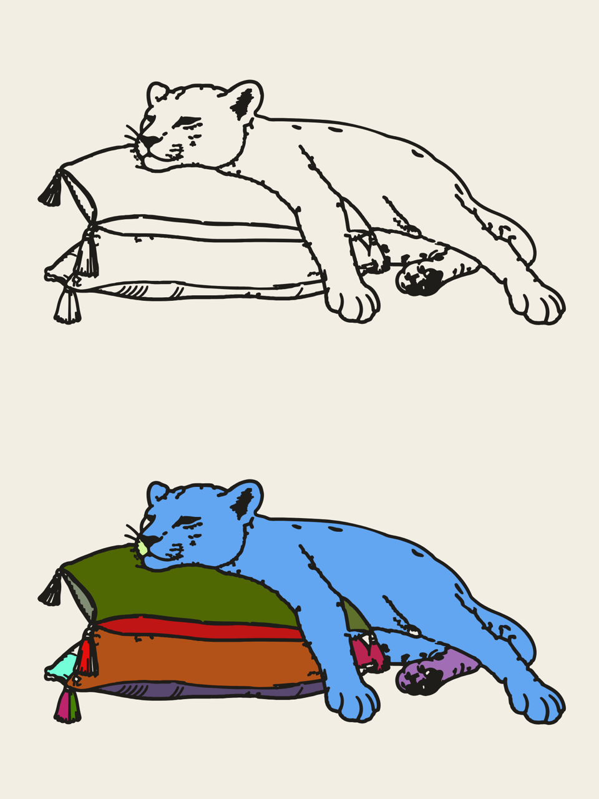

# Leopard: bold outline (vector)

A vector of the bold-outline region map: the minimal leopard line art thickened evenly, without the debug colours.

- `leopard-bold.svg`: black line on cream
- `leopard-bold-transparent.svg`: no background

`#ink` is the line work. `#regions` holds the 14 enclosed areas (leopard body, snout, back paw, each cushion band,
tassels…) as separate shapes `region-01` … `region-14`, cream by default. They sit just under the line, so you can
give any area its own colour without gaps. The bottom of the preview shows that with random test colours.

Regenerate: `python3 src/bold.py` (after the `../leopard-lineart` pipeline).
