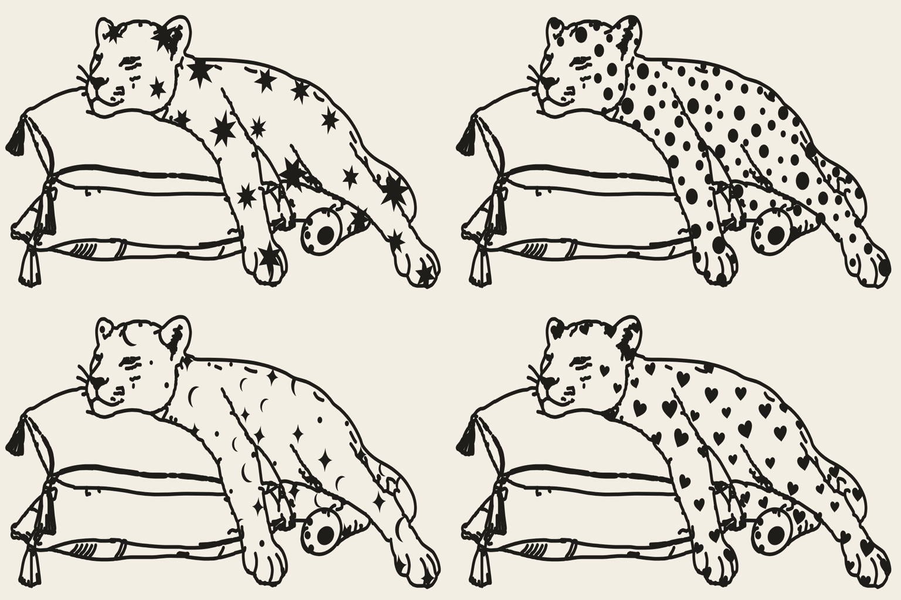

# Leopard: bold monoline with skin options

The original resting-leopard drawing as a clean vector with one even, bold stroke. The forms are the
original's (eye, nose, fur waves, toes, tassels); only the line is rebuilt. The rosettes are gone, and the
"skin" is a separate group clipped to the body outline, so it can be swapped.



| File | Skin |
| --- | --- |
| `leopard-monoline.svg` | No skin, just the clean line |
| `leopard-skin-stars.svg` | Bold 6–8 point stars, cut off at the body outline |
| `leopard-skin-dots.svg` | Polka dots in mixed sizes |
| `leopard-skin-celestial.svg` | Crescent moons, sparkles and dots |
| `leopard-skin-hearts.svg` | Small solid hearts |

In each SVG: `#lines` holds every line as a true stroke (`stroke-width` 8.5, round caps), so changing that one
number re-weights the whole drawing. `#fills` holds the nose, eye, inner ear and paw pads, and `#skin` holds the pattern, clipped by `#body`.

Regenerate (needs `pip install opencv-python-headless vtracer scikit-image skan numpy`, and the
`../leopard-lineart` pipeline run first):

```sh
cd illustrations/leopard-folk
python3 src/monoline.py && python3 src/skins.py
```
`src/skins.py` controls pattern sizes, spacing and seeds (`place(min_r, max_r, gap, seed)`).
