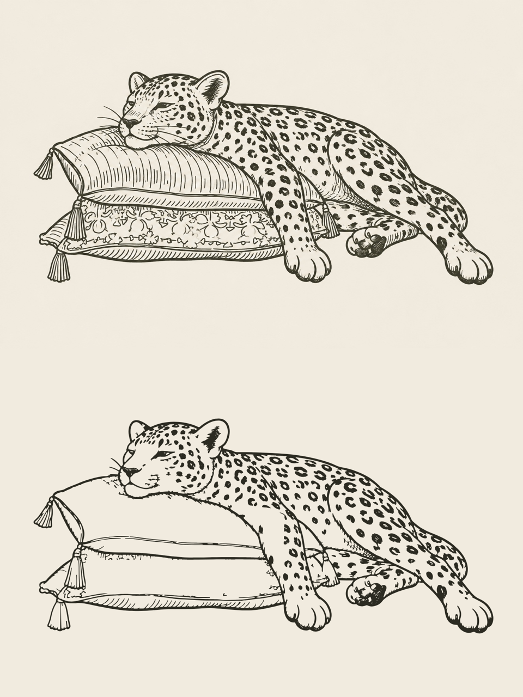
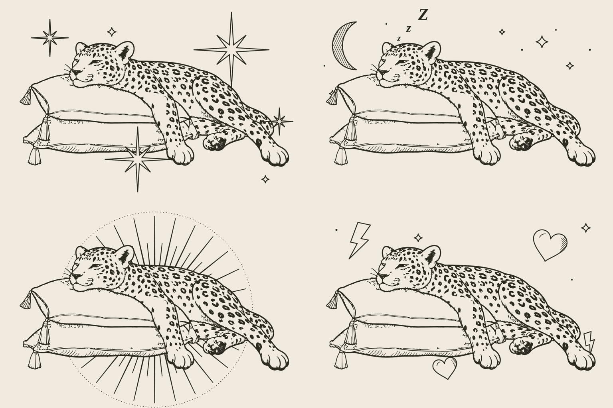

# Resting leopard — simplified line art (vector)

A vector version of the pen-and-ink leopard-on-cushions drawing with less detail, keeping the same hand-inked line.



- `leopard-lineart.svg`: ink `#2c2b22` on paper `#f1ebdf`
- `leopard-lineart-transparent.svg`: the same drawing with no background

What was simplified: the cushion hatching and the ornamental band are gone, and there are fewer fur flicks.
The outlines, spots, tassels, piping, face and whiskers stay as drawn. Every line is traced from the original
artwork, so the stroke weight still looks hand-drawn. The ink is one group (`#ink`), so you can recolour it in one place.

Regenerate (needs `pip install opencv-python-headless vtracer numpy`):

```sh
cd illustrations/leopard-lineart
python3 src/compose.py && python3 src/trace.py
```
`src/simplify.py` sets how much detail is removed (`LEVELS`). `src/compose.py` decides which level each region uses.

## Compositions with shapes

`compositions/` puts the leopard with decorative shapes drawn in the same ink style: cream fill, matching outline
weight and engraving-style hatching. Each file has `behind`, `leopard` and `front` groups, so a shape can be moved
in front of or behind the leopard. A solid silhouette (`src/silhouette.py`) stops shapes behind it from showing through.



- `a-sparkles.svg`: thin-rayed sparkle stars, like the reference
- `b-moon-and-stars.svg`: crescent moon, twinkles and "z z Z" (fits *Resting*)
- `c-sunburst.svg`: a ray halo behind the leopard
- `d-hearts-and-bolts.svg`: tattoo-flash hearts and lightning bolts

Shapes and positions are set in `src/compositions.py` (`python3 src/compositions.py`).
