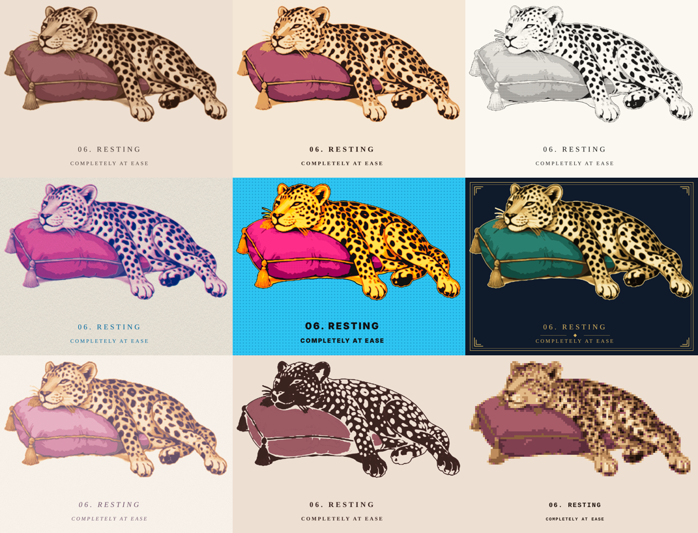

# 06. Resting — vector + style variations

A vector (SVG) version of the *06. Resting / Completely at ease* leopard illustration, plus eight restyled versions.



| File | Style |
| --- | --- |
| `01-vector-faithful.svg` | Faithful vector trace: 14 colour layers matching the original |
| `02-flat-poster.svg` | Flat poster: the same shapes in 6 flat colours |
| `03-ink-engraving.svg` | Ink engraving: black-and-white with hatching and cross-hatching for tone |
| `04-risograph.svg` | Risograph: two inks (fluoro pink and blue) overprinted, slightly off-register, with grain |
| `05-pop-art.svg` | Pop art: loud flat colours, halftone dots, heavy outline |
| `06-art-deco.svg` | Art deco: gold-leaf leopard, emerald cushion, midnight blue, gold frame |
| `07-watercolour.svg` | Watercolour: pastel washes, soft wobbly edges, paper texture |
| `08-stencil.svg` | Stencil: dark silhouette with the spots knocked out |
| `09-pixel-art.svg` | Pixel art: a sprite made from `<rect>`s, to match the site's Win95 desktop |

## How it's made

The artwork is cropped from `src/original.jpg` (the cut-off bell on the left edge is dropped), split into 14 tones,
and each tone is traced into stacked vector shapes. Every style reuses those same shapes with a different palette,
pattern or SVG filter, so the layers line up across all versions. Each tone is a named group (`tone-01` … `tone-13`)
in the file's `<defs>`, which makes the colours easy to change in Illustrator, Figma or Inkscape.

The captions are live `<text>`, not outlines. They use Cormorant Garamond if it's installed and fall back to another
serif. Convert them to outlines in your editor before sending a file to print.

Regenerate everything (needs `pip install opencv-python-headless vtracer numpy`):

```sh
cd illustrations/leopard-resting
python3 src/trace.py && python3 src/layers.py && python3 src/make_all.py
```
